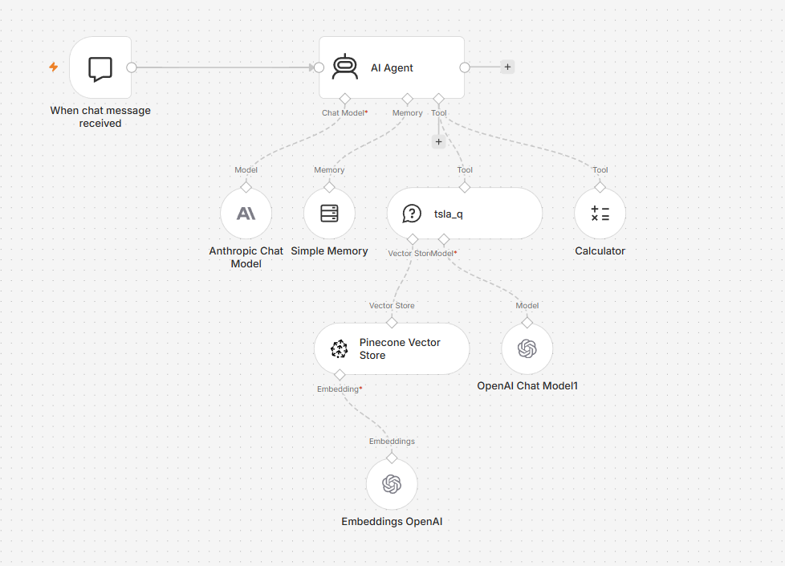
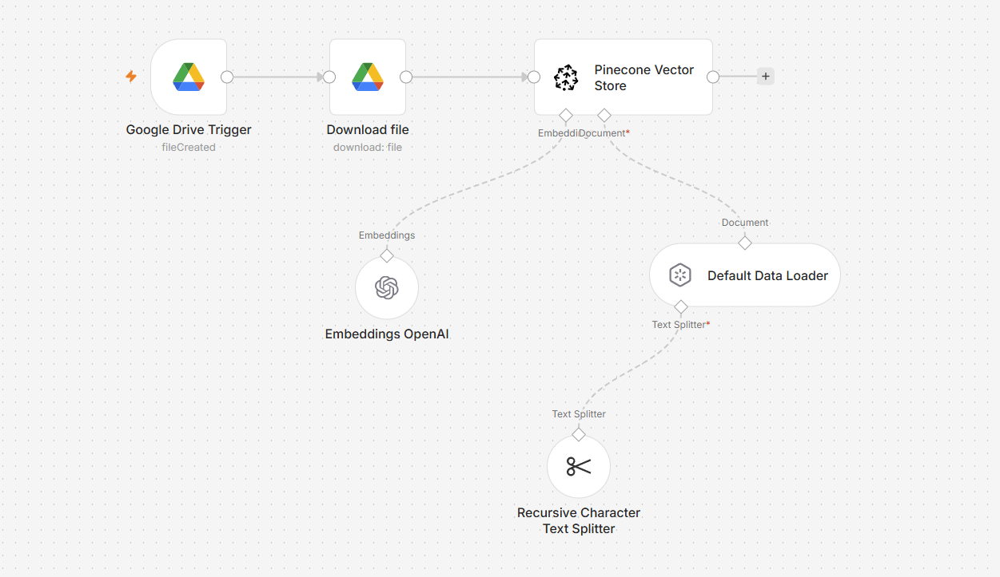
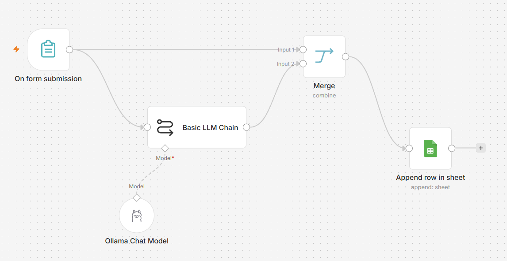

# n8n AI Agents

Three AI workflows built in n8n: a retrieval-augmented (RAG) chat agent, the ingestion pipeline that feeds it, and an LLM sentiment classifier.

## 1. RAG Document Q&A Agent (`rag-agent.json`)
A chat agent that answers questions about Tesla's Q3 and Q4 2024 quarterly reports.
- **Agent model:** Claude (Anthropic), with a system prompt that restricts answers to retrieved content and cites which report each figure came from
- **Tools:** a vector-store retrieval tool (Pinecone) and a calculator for derived figures
- **Retrieval model:** the Pinecone search tool uses GPT-4o to summarize the retrieved chunks before passing them to the agent
- **Memory:** windowed conversation memory (last 10 messages) for follow-up questions

## 2. Document Ingestion Pipeline (`ingestion-pipeline.json`)
Watches a Google Drive folder and automatically adds new PDFs to the knowledge base.
- Google Drive trigger → download → PDF loader
- Recursive character text splitting (900-character chunks, 50 overlap)
- OpenAI embeddings → Pinecone vector store

## 3. Sentiment Analysis (`sentiment-analysis.json`)
Classifies form-submitted reviews as Positive, Negative, or Neutral, then logs the result to Google Sheets.
- **Model:** deepseek-r1:7b through Ollama, running fully locally
- **Prompt:** instructs the model to respond with a single sentiment label
- **Output:** the reviewer's name and sentiment label are appended to Google Sheets

## Example results from the RAG agent
Answers were checked against the source reports.

**What was Tesla's free cash flow in Q4 2024?**
> $2.0 billion, from the Q4 2024 report. ✅ Correct

**How did total revenue change between Q3 and Q4 2024?**
> Q3 2024: $25.182B → Q4 2024: $25.707B, a change of +$525M (+2.1% quarter over quarter), with a Q4 breakdown of $19.80B automotive, $3.06B energy, and $2.85B services. ✅ Correct, using figures from both reports and the calculator tool

**What did Tesla say about its outlook for 2025?**
> Covered FSD and Robotaxi plans, more affordable models, Semi production starting by end of 2025, and Cybercab volume production in 2026 at Gigafactory Texas. ⚠️ Mostly correct: it described the New Model Y production ramp as already started, while the report says it begins later in Q1, and it missed the Outlook section's guidance on vehicle growth and 50%+ energy storage growth.

**Next improvement:** add the report section and page to each retrieved chunk's metadata so the agent can cite more precisely and pull from the dedicated Outlook section.

## Stack
n8n · Anthropic Claude · OpenAI (embeddings, GPT-4o) · Pinecone · Ollama · Google Drive · Google Sheets

## Setup
Import each JSON file into n8n, then add your own credentials for Anthropic, OpenAI, Pinecone, Google, and Ollama. No API keys are included in these files. Replace the placeholder Google Drive folder and Sheet IDs with your own, and create a Pinecone index to match.
