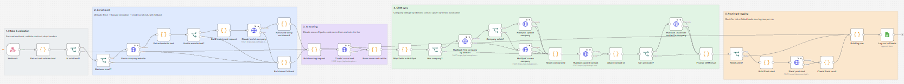
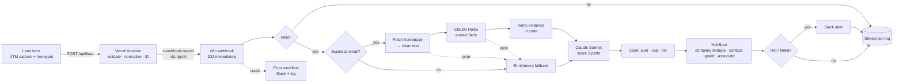
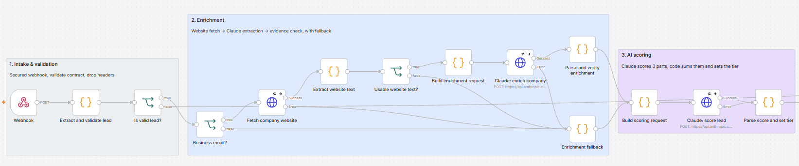
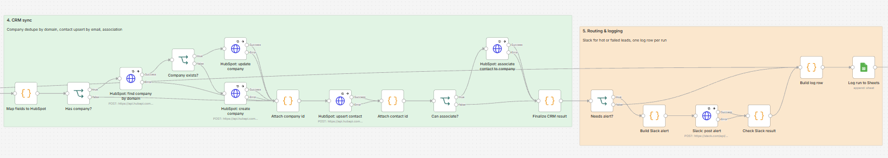

# Inbound Lead Pipeline: Capture → Enrich → AI Score → CRM → Route

An end-to-end GTM data pipeline for a B2B healthtech company selling to health plans, providers and employers. A lead submitted on a web form is validated, enriched from the company's own website, scored by Claude against an ideal customer profile, deduplicated into HubSpot, routed to Slack if it's hot, and logged, with a failure path designed so no lead disappears silently.

**Live demo form:** [philip-adams-portfolio.vercel.app/lead-demo.html](https://philip-adams-portfolio.vercel.app/lead-demo.html) *(the n8n backend runs on my machine, so the form shows a clear error when it's offline)*
**Walkthrough video:** _Loom link_



---

## What it does

| Stage | What happens |
|---|---|
| **Capture** | Static HTML form with first-touch UTM capture (stored for 90 days across the whole site), honeypot spam trap, field-level validation errors |
| **Serverless intake** | Vercel function validates and normalizes the lead, assigns a `submission_id`, and forwards it to n8n with a shared secret, retrying only recoverable failures |
| **Enrichment** | Fetches the company homepage, strips it to clean text, and has Claude Haiku extract industry, ICP segment and size, then **verifies the evidence in code** |
| **AI scoring** | Claude Sonnet scores three parts (segment fit, role fit, intent); code adds them up, applies business rules and sets the tier |
| **CRM sync** | Company deduplicated by domain (search → create or update), contact upserted by email, contact associated to company |
| **Routing** | Slack alert for hot leads, failed scores, and failed CRM saves; warm and nurture leads are tagged in HubSpot |
| **Logging** | One Google Sheets row per run (IDs and outcomes, no personal data); a separate error workflow catches crashes |

---

## Architecture






---

## Key design decisions

**Enrichment: website + LLM, with evidence checked in code.** I tested Hunter's free Company Enrichment API first: it returned technographics and partial funding data but null firmographics (no industry, size or description), and one funding round had an amount of just `"$"`. I chose not to put unreliable data into scoring. Instead the pipeline reads the company's own homepage. Claude must quote the exact text supporting any company-size claim, and code checks that quote actually appears on the page. If it doesn't, size becomes `unknown`. Prompting alone wasn't enough: in early testing Claude estimated a size the page never stated.

**Scoring: Claude scores parts, code decides.** Claude returns `segment_fit` (0–40), `role_fit` (0–30), `intent` (0–30) and a reason. Code clamps the ranges, adds them up, and applies the tier thresholds (hot ≥ 75, warm ≥ 45). That makes scores explainable ("right company, wrong person") and tunable without touching the prompt.

**Business rules stay in code.** A lead with a free email address can't be scored above 74: the company can't be verified, so it can't trigger a hot alert, however convincing the form text is.

**Structured output everywhere.** Enrichment uses forced tool use; scoring uses JSON structured outputs (Sonnet 5.5 doesn't accept forced tool choice). Enum values match HubSpot dropdown options exactly, so the model can't produce a value the CRM would reject.

**Dedupe uses the right tool per object.** Email is a unique key for HubSpot contacts, so contacts use an atomic batch upsert. Company domain isn't unique, so companies use search → create/update. The pipeline only updates the fields it owns on existing companies; it never overwrites a rep's manual edits.

**Attribution is first-touch.** UTMs are captured on whichever page the visitor lands on and kept for 90 days, so a lead submitted later from a different page is still credited to the campaign that brought them in.

---

## Example: input and output

**What the Vercel function sends to n8n** (fictional person):

```json
{
  "submission_id": "f91f0777-0291-4c...",
  "submitted_at": "2026-10-24T17:18:02.114Z",
  "name": "Priya Raman",
  "email": "priya.raman@clevelandclinic.org",
  "email_domain": "clevelandclinic.org",
  "is_free_email": false,
  "company": "Cleveland Clinic",
  "role": "Director, Managed Care Contracting",
  "message": "We're preparing for payer renegotiations next quarter and need market rate benchmarks for our top 50 procedures. Can we see a demo?",
  "utm_source": "linkedin",
  "utm_medium": "paid_social",
  "utm_campaign": "q4_health_plans"
}
```

**What comes out:**

```json
{
  "enrichment": { "status": "enriched_website", "industry": "Hospital system", "icp_segment": "provider", "size_estimate": "unknown", "confidence": "high" },
  "scoring": {
    "status": "scored", "score": 96, "tier": "hot",
    "parts": { "segment_fit": 39, "role_fit": 29, "intent": 28 },
    "reason": "Director of Managed Care Contracting at a major health system needs market rate benchmarks for payer renegotiations next quarter and asked for a demo. Biggest gap is minor: no budget or decision-process detail."
  },
  "crm": { "company": { "action": "created" }, "contact": { "action": "created" }, "association": { "status": "associated" } },
  "alert": { "status": "sent" }
}
```

**Three test leads, side by side:**

| Lead | Enrichment | Segment | Parts (seg / role / intent) | Score | Tier | Alert |
|---|---|---|---|---|---|---|
| Director, managed care contracting at a health system; demo request with a timeline | enriched | provider | 39 / 29 / 28 | 96 | **hot** | sent |
| VP network development, gmail address, decision "by end of month" | skipped (free email) | — | capped by rule | 74 | **warm** | — |
| Marketing coordinator at an e-commerce company, "just browsing" | enriched | other | — | 8 | **nurture** | — |

Two contacts at the same company, scored 96 and 84, show the intent part doing its job: same segment and seniority, but one message described an active evaluation and the other only a timeframe.

---

## Reliability: how no lead is lost

| Failure | What happens |
|---|---|
| Invalid form input | Field-level errors in the form; nothing is sent |
| n8n unreachable from Vercel | 3 attempts, recoverable errors only; then a clear error to the visitor, with their input kept so they can resend |
| Company website down or blocked | Lead continues with `enrichment_status: failed` and is still scored and saved |
| Claude unavailable or returns bad output | Enrichment falls back; scoring is marked `failed` and triggers a "needs manual review" Slack alert |
| HubSpot company call fails | Contact is still saved, without the company link; the error is logged |
| HubSpot contact save fails | Slack alert: "Lead NOT saved to HubSpot, save it manually" |
| Slack returns `ok: false` (HTTP 200) | Detected in code and logged as a failed alert |
| Unexpected crash anywhere | Error workflow posts the failed node and error to Slack, logs a `crashed` row, and the failed execution keeps the lead's data so it can be retried |

---

## Security and data handling

- **No credentials in this repo.** n8n exports reference credentials by name and ID only; Vercel secrets live in environment variables. Exports were scanned before committing.
- **Least privilege.** HubSpot Service Key with 8 scopes (contacts/companies, objects and schemas only); Slack bot with `chat:write` only; Google service account with no project roles, shared on one sheet; workspace-scoped Anthropic key.
- **The webhook is authenticated** with a shared-secret header, tested on both the reject and accept paths. Headers are dropped at the first node so the secret doesn't travel through the workflow.
- **Untrusted input is treated as untrusted.** Website text and lead messages are labelled as data in prompts (prompt-injection defense), and lead text is escaped before posting to Slack (so nobody can trigger `<!channel>`).
- **The log records events, not people.** The run log holds IDs, outcomes and token counts; names, emails and messages stay in the CRM.

---

## Cost per lead

| Step | Model | Typical tokens | Cost |
|---|---|---|---|
| Enrichment | Claude Haiku 5.5 | ~2,500 in / ~270 out | ≈ $0.0004 |
| Scoring | Claude Sonnet 5.5 | ~1,100 in / ~120 out | ≈ $0.0034 |
| **Total** | | | **≈ $0.004 per lead** (~$3.80 per 1,000) |

Scoring is about 90% of the cost. Moving it to Haiku would cut the total to roughly $0.0006 per lead, a trade between cost and judgment quality. Token counts are logged per run, so this is measured, not estimated.

---

## Limitations and what I'd do in production

- **n8n runs locally behind an ngrok tunnel.** In production it would be hosted, behind a reverse proxy exposing only `/webhook/*`.
- **No durable queue between Vercel and n8n.** If n8n is down, the visitor is told and can resend, but nothing is held for later. Production would add a queue (e.g. SQS or QStash) as a dead-letter buffer.
- **Company dedupe has a race window.** HubSpot's search index lags a few seconds behind writes, so two leads from the same new domain within seconds could create duplicate companies. Fixes at scale: queue per domain, or a scheduled reconciliation job.
- **LLM scores vary by a point or two between runs.** Tiers are stable because the bands are wide; near-threshold leads could be scored twice and averaged.
- **Single-page enrichment.** Only the homepage is read; an About page or a licensed firmographic provider would improve size and industry coverage.

---

## Running it yourself

1. **HubSpot:** create a Service Key with the scopes above, turn off automatic company creation, then import and run `workflows/hubspot-schema-setup.json` to create the custom properties.
2. **n8n:** import `workflows/lead-pipeline.json` and `workflows/lead-pipeline-errors.json`, create credentials with these names, and link the error workflow in the main workflow's settings:
   - `HubSpot Service Key - Lead Pipeline` (Bearer Auth)
   - `Anthropic API Key` (Header Auth, `x-api-key`)
   - `Lead Intake Webhook Secret` (Header Auth, `x-webhook-secret`)
   - `Slack Bot Token - Lead Pipeline` (Bearer Auth)
   - `Google Sheets - Lead Log (service account)`
3. Update the Slack channel ID, HubSpot portal ID and Sheet URL in the workflow to your own.
4. **Vercel:** deploy `vercel/lead.js` as `api/lead.js` in your Vercel project, with `N8N_WEBHOOK_URL` and `N8N_WEBHOOK_SECRET` set; serve `vercel/lead-demo.html` and `vercel/utm.js`.
5. **Test:** `test-leads/hot-lead.json` exercises the full path; `test-leads/crash-lead.json` is for crash-path testing (it only crashes with the deliberate test line in place).

## Structure

```
lead-pipeline/
├── workflows/
│   ├── lead-pipeline.json          main pipeline
│   ├── lead-pipeline-errors.json   crash handler
│   └── hubspot-schema-setup.json   creates HubSpot custom properties
├── vercel/
│   ├── lead.js                     serverless intake (deployed as api/lead.js)
│   ├── lead-demo.html              demo form
│   └── utm.js                      first-touch UTM capture
├── test-leads/                     fictional test payloads
└── docs/                           screenshots
```

*Test data uses fictional people. Public company websites are used only as enrichment test inputs; there is no affiliation with those companies.*
